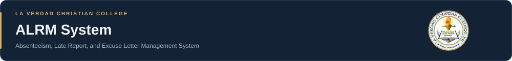
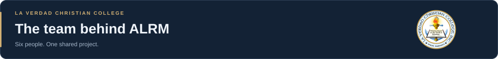
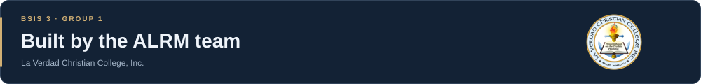

### Absenteeism, Late Report, and Excuse Letter Management System

A web-based **Absenteeism, Late Report, and Excuse Letter Management System** for **La Verdad Christian College, Inc.**.

**BSIS 3 · Group 1**

[Live Application](https://absenteeism-late-report-and-excuse.vercel.app/) · [Figma Design](https://www.figma.com/design/tbmJgm9nCtJfOgPXWYHzaj/ALRM-SYSTEM) · [Business Requirements Document](https://docs.google.com/document/d/1nFqp-fZCyO5j8qZaa6OuOl0lhVbuSWaB7XOIJWw5GpU/edit?tab=t.0) · [Project Presentation](https://docs.google.com/presentation/d/1IgaBUyXhlFN-42n0C0u3XsV2WxP67OlfTjqVxvPM1ek/edit?slide=id.p1#slide=id.p1)

## About the Project

The existing process for handling student absence and late reports relies on paper forms, Google Forms, spreadsheets, and Viber. The College Secretary manually forwards each request to the appropriate Instructor, students wait for updates, and submitted reports and excuse letters are spread across separate tools.

ALRM supports the submission, routing, review, and status tracking of absenteeism reports, late reports, and excuse letters through a centralized web platform.

The assigned **Instructor retains authority over request validity**. The system supports routing, recording, monitoring, and communication throughout the process.

## Project Objectives

- Replace manual forwarding with automatic routing to the Instructor assigned to the selected class.
- Give students visibility into their submitted requests and decisions.
- Allow Instructors to review requests and supporting evidence in one place.
- Notify students about updates to their reports and excuse letters.
- Organize submitted reports and excuse letters according to user access.

## Team Hierarchy

<table>
  <tr>
    <td colspan="5" align="center">
       
       
      <h3>Jimuel Jarina</h3>
      
      
Leads planning, schedules, and team coordination. Oversees the project charter, Gantt chart, RACI matrix, and requirements review.

    </td>
  </tr>
  <tr>
    <td colspan="5" align="center"></td>
  </tr>
  <tr>
    <td width="20%" align="center"></td>
    <td width="20%" align="center"></td>
    <td width="20%" align="center"></td>
    <td width="20%" align="center"></td>
    <td width="20%" align="center"></td>
  </tr>
  <tr>
    <td align="center" valign="top"><strong>Mac Robert Savandal</strong></td>
    <td align="center" valign="top"><strong>Marwin Mandocdoc</strong></td>
    <td align="center" valign="top"><strong>Janice Agnote</strong></td>
    <td align="center" valign="top"><strong>Angelene Ariate</strong></td>
    <td align="center" valign="top"><strong>Rancel Cuervo</strong></td>
  </tr>
  <tr>
    <td align="center" valign="top"></td>
    <td align="center" valign="top"></td>
    <td align="center" valign="top"></td>
    <td align="center" valign="top"></td>
    <td align="center" valign="top"></td>
  </tr>
  <tr>
    <td align="left" valign="top">Builds React interfaces, reusable components, and styling, and integrates the API.</td>
    <td align="left" valign="top">Develops the Laravel API, database, Google SSO, access control, and request workflows.</td>
    <td align="left" valign="top">Gathers requirements, prepares the BRD, and conducts DMAIC analysis and requirements review.</td>
    <td align="left" valign="top">Creates user flows, wireframes, and Figma prototypes for the four system roles.</td>
    <td align="left" valign="top">Prepares test plans and cases, records test results, and tracks defects.</td>
  </tr>
</table>

## System Users

The application has four user roles, distinct from the development team's roles above.

| User role | Main responsibilities |
|---|---|
| **Student** | Submit absence or late requests with optional evidence, edit or cancel own pending requests, follow up, and view own records and notifications. |
| **Instructor** | Review requests and evidence for assigned classes, review explanations, and access reports for their assigned classes. |
| **Program Head** | View program-scoped absenteeism reports, late reports, and excuse-letter records, and coordinate request follow-ups. |
| **Administrator / College Secretary** | Manage accounts, roles, programs, curriculum, classes, meeting details, and instructor assignments; access college-wide dashboards, reports, and activity logs. |

## Request Workflow

1. **Sign in:** The student accesses ALRM through Google SSO.
2. **Submit:** The student selects an enrolled class and submits an absence or late report with optional supporting evidence.
3. **Route:** The system identifies the assigned Instructor and routes the request directly to their dashboard.
4. **Review:** The Instructor examines the explanation and evidence, then records a decision.
5. **Track:** The student views the updated request status and notifications.
6. **Follow up:** The student follows up on pending reports or excuse letters.

## Core Features

- Google SSO, email verification, and role-based access.
- Digital absence and late reports with optional supporting documents.
- Automatic routing based on class and Instructor assignments.
- Evidence viewing and request decision workflows.
- Student request history, pending-request editing/cancellation, and follow-ups.
- Dashboards scoped to student, class, program, or college records.
- Email and in-app notifications.
- Account, curriculum, class, and Instructor assignment management.
- Activity logs and role-scoped Excel/CSV reports.

## Technology Stack

| Layer | Technology |
|---|---|
| Frontend | React 19, Vite 8, React Router 7 |
| UI and styling | Tailwind CSS 4, shadcn/ui, Lucide icons |
| Backend | Laravel 13, PHP, Eloquent ORM |
| Authentication | Google SSO, Laravel Socialite, Sanctum, frontend cookie gateway |
| Database | TiDB Cloud / MySQL-compatible database |
| Evidence storage | Database-backed attachments |
| Hosting | Vercel for the frontend and gateway; Render for the Laravel API |

The browser sends same-origin `/api/*` requests through the frontend gateway to Laravel. The API enforces account status, role permissions, and record-level authorization before accessing application data. Dependency ranges are listed in [frontend/package.json](frontend/package.json) and [backend/composer.json](backend/composer.json).

## Project Scope

**In scope:** Management of absenteeism reports, late reports, and excuse letters, including submission, routing, review, request status tracking, follow-ups, and related notifications and records.

**Out of scope:** Automated timetable generation, grade computation, native mobile applications, automated validity decisions, direct Registrar database integration, and Discipline Office case management.

## Project Resources

- [Live Application](https://absenteeism-late-report-and-excuse.vercel.app/)
- [Business Requirements Document](https://docs.google.com/document/d/1nFqp-fZCyO5j8qZaa6OuOl0lhVbuSWaB7XOIJWw5GpU/edit?tab=t.0)
- [Final Project Presentation](https://docs.google.com/presentation/d/1IgaBUyXhlFN-42n0C0u3XsV2WxP67OlfTjqVxvPM1ek/edit?slide=id.p1#slide=id.p1)
- [Figma Design](https://www.figma.com/design/tbmJgm9nCtJfOgPXWYHzaj/ALRM-SYSTEM)
- [API Documentation](backend/docs/API-DOCS.md)
- [Backend Notes](backend/BACKEND.md)

Project descriptions and team responsibilities are based on the supplied BRD and presentation. Technical details are aligned with the code and dependency manifests available in this branch.

