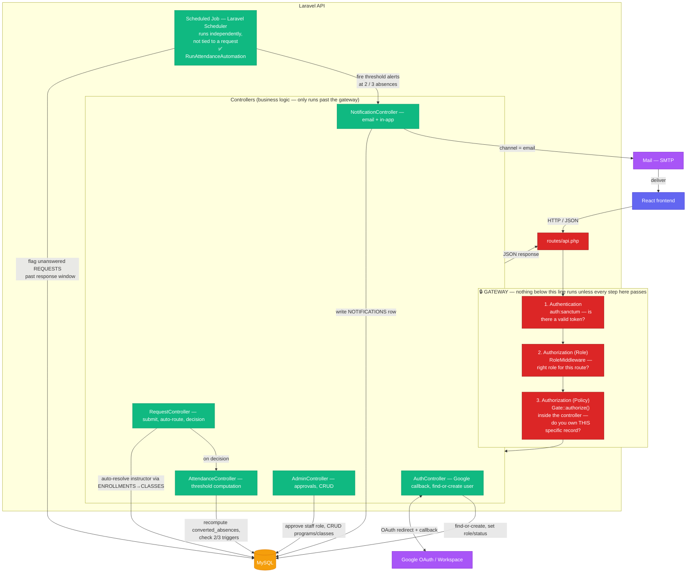

# ALRM — Backend Implementation Guide
### Laravel API Documentation & TODO (v1.0 / MVP)

> This is the backend-only companion to `ALRM.md`. Purpose: a working guide while building the Laravel API — what already exists, what's missing, and in what order things should be done.

---

## 1. Scope Reminder

The backend (Laravel REST API) is responsible for:
- Auth + role-based access (4 roles only: **Administrator, Program Head, Instructor, Student** — no College Secretary role; that manual relay function is automated away by the system)
- Auto-routing excuse/late requests to the correct instructor (based on schedule, not manual)
- Policy enforcement: 3 lates = 1 absence; alerts at 2 absences (warning) and 3 absences (IR/minor offense)
- Follow-up flagging (scheduled job) when a request goes unanswered past the response window
- Notifications (email + in-app)
- Reports/exports and audit trail

**Not in scope here (frontend's job):** UI/UX, dashboards, React-side routing, styling.

---

## 2. Tech Stack (Backend)

| Layer | Technology | Note |
|---|---|---|
| Framework | **Laravel 13** (PHP ^8.4) | per `composer.json` |
| Database | **MySQL** (production and local dev via Laragon) | local dev already on MySQL — no SQLite involved |
| Auth | **Google OAuth/SSO (Laravel Socialite)** + custom role-based middleware | ✅ Done — see §8 Priority 2 |
| Authorization | **Policies + Gate** (`app/Policies`, registered in `AppServiceProvider::boot()`) | ⚠️ Just started — see §6.1 |
| Mail | Laravel Mail (SMTP) | `.env` already has `MAIL_*` vars, currently on `log` driver. Not wired to any notification yet. |
| Hosting | Render | `.env` should point `DB_*` to an external MySQL-compatible host — **not** Render's own disk, since the free tier has no persistent storage. **Decision:** using **TiDB Cloud** (Serverless tier, MySQL-compatible, free tier, native FK support) — see §7 for connection details. |

---

## 2.1 Authentication & Authorization — The Gateway

Every single request that isn't the public Google OAuth handshake passes through **two gates in sequence** before it ever reaches a controller. Neither gate is optional, and they answer two different questions:

| Gate | Question it answers | Where it lives | Granularity |
|---|---|---|---|
| **Authentication** | "Who are you?" | `auth:sanctum` middleware + `AuthController` | Is there a valid token at all? |
| **Authorization — Role** | "What *kind* of user are you?" | `RoleMiddleware` (route-level, `api.php`) | Coarse — blocks by role, before the controller runs |
| **Authorization — Policy** | "Do you own/control *this specific record*?" | `app/Policies/*` via `Gate` (called inside the controller) | Fine — blocks by ownership, even within the same role |

**This is exactly your student/CRUD example:**
1. A student account calls `POST /api/admin/programs`.
2. `RoleMiddleware` on that route group is `role:administrator`. The student's `role` is `student`, not `administrator` — **request dies right here with a 403**, before `Admin\ProgramController` even runs. This is the Role gate.
3. Now take a *different* scenario where the role gate alone isn't enough: two different instructors, both with `role: instructor`. Instructor A calls `PATCH /api/instructor/requests/{id}/decision` on a request filed under Instructor B's class. `RoleMiddleware` lets it through — A really is an instructor. But `InstructorRequestController::decide()` calls `$this->authorize('decide', $request)`, which runs `ExcuseRequestPolicy::decide()` — that checks `$request->enrollment->class->instructor_id === $user->id`, which is false for A. **403, this time from the Policy gate**, because the Role gate alone can't tell two instructors apart.

So: **Role gate = "are you even the right type of user for this endpoint at all"**, **Policy gate = "even though you're the right type, is this specific record actually yours."** Every write/decision endpoint needs to ask both questions; only asking the first is how you'd end up with Instructor A approving Instructor B's students.

**Current coverage:**
| Resource | Role gate | Policy gate |
|---|---|---|
| `ExcuseRequest` (view/decide) | ✅ `role:student\|instructor\|program_head` | ✅ `ExcuseRequestPolicy` |
| `Program`, `ClassModel` CRUD | ✅ `role:administrator` | ✅ `ProgramPolicy`, `ClassModelPolicy` — wired via `$this->authorize()` in `Admin\ProgramController` / `Admin\ClassManagementController` |
| `FollowupFlag`, `AttendanceTracker`, `User` | ✅ role gate | ✅ `FollowupFlagPolicy`, `AttendanceTrackerPolicy`, `UserPolicy` — wired into `ProgramHead\FollowupFlagController`, `Student\AttendanceController@summary`, `Admin\UserApprovalController@approve` respectively |
| Program Head routes, for a user whose `role` is `instructor` but who is *also* a Program Head | ✅ **done** — `RoleMiddleware` grants access via `Program::where('program_head_id', $user->id)->exists()` even when `role !== 'program_head'` | n/a — this is a Role-gate change, not a Policy | See §9.1a |

---

How a request actually flows through the Laravel API — routing, auth, business logic, and the scheduled job that runs independently of any request.



**Read the diagram top-down, literally as a gate:** a request that fails step 1, 2, or 3 never reaches a controller at all — it gets a 401/403 straight from the gateway layer. Only a request that clears **all three** ever touches business logic or the database. This is deliberate: it means every controller method can *assume* "the caller is authenticated, is the right role, and owns this record" without re-checking any of that itself — the one exception being `store()`-type actions where there's no existing record to own yet (e.g. a student submitting a new request), which only need gates 1 and 2.

**Key points this diagram is enforcing:**
- **Auth is a redirect dance, not a form POST** — the browser leaves the app, goes to Google, comes back to `AuthController`'s callback. Domain validation happens *inside* that callback, every time, not just at "registration."
- **The scheduled job is decoupled from the request/response cycle.** It's the only thing in this system that runs on its own timer (Laravel Scheduler → cron), not triggered by a user action. This is what powers follow-up flagging and threshold notifications — don't try to compute those inline inside a controller.
- ⚠️ **Current implementation violates the point above.** `InstructorRequestController::applyToTracker()` fires threshold notifications (warning/IR) *synchronously, inline, inside the decide() request*. It works for the demo, but it's the wrong long-term shape — a request can only trigger a threshold crossing if an instructor happens to act on it; a student who's been ghosted never gets flagged. See §9.1 for the fix.
- ⚠️ **`FOLLOWUP_FLAGS` is currently used for the wrong trigger.** Per the original BPM proposal (`ALRM_Project.pdf`, Step 4 — Lead Information), a follow-up flag is supposed to fire when **a request sits unanswered by an instructor past a time window** — not when a student crosses into IR. The current code creates a `FollowupFlag` on IR-crossing instead. Needs correcting when the scheduled job is built (§9.1).
- **`RequestController` never asks the client who the instructor is.** It resolves that itself via `ENROLLMENTS → CLASSES.instructor_id`, per the auto-routing requirement.
- **`NotificationController` sits between the job/controllers and two different outputs** (DB row for in-app, Mail for email) — both driven by the same `channel` field on `NOTIFICATIONS`, so a single alert can go out both ways without duplicating logic. Not built yet — notifications currently only ever write `channel = 'in_app'`, nothing sends email.

---

## 4. Current State (as of this scan)

Based on the files in `/backend`:
- ✅ All migrations created (PROGRAMS, CLASSES, ENROLLMENTS, ATTENDANCE_TRACKER, REQUESTS, FOLLOWUP_FLAGS, NOTIFICATIONS, AUDIT_LOG), plus role/status/year_level/guardian_name/contact_number columns on `users`
- ✅ Eloquent models created for each table + relationships, all verified against the ERD
- ✅ `routes/api.php` created and registered in `bootstrap/app.php` (`withRouting`)
- ✅ Auth & Role System done: Socialite (Google) configured, `AuthController` (redirect/callback/logout/me), `RoleMiddleware` (per-role guard), `Admin/UserApprovalController` (staff-only role-assignment queue — students are never in this queue, they're auto-approved at login; see §9.1a for the outstanding Instructor+Program Head middleware fix)
- ✅ **Priority 3 (Core Business Logic) done:** `RequestController` (store/index/show, auto-routes instructor via enrollment), `AttendanceTracker::recompute()` threshold engine, `InstructorRequestController::decide()`, `AttendanceController::summary()`, student `ClassController::index()`
- ✅ **Priority 5 done:** `ProgramHeadDashboardController` (dashboard/flaggedStudents/requests), `Admin\ProgramController` + `Admin\ClassManagementController` (full CRUD), `Admin\AdminDashboardController`, `Admin\ReportController::export()` (CSV — see note below), `ProgramHead\FollowupFlagController` (index/resolve)
- ✅ Authorization layer complete: `ExcuseRequestPolicy`, `ProgramPolicy`, `ClassModelPolicy`, `FollowupFlagPolicy`, `AttendanceTrackerPolicy`, `UserPolicy` — all registered via `Gate::policy()` in `AppServiceProvider::boot()` and called via `$this->authorize()` from their respective controllers — see §6.1
- ✅ **`Admin\AdminDashboardController`** — built.
- ✅ Scheduled job built (threshold notifications + follow-up flagging) — `app/Console/Commands/RunAttendanceAutomation.php`, registered in `routes/console.php`
- ✅ **Audit trail writes done** — `app/Services/AuditLoggerService.php` (Service Pattern), wired into `Admin\UserApprovalController`, `Admin\ProgramController`, `Admin\ClassManagementController`, `Instructor\InstructorRequestController`, `ProgramHead\FollowupFlagController` — see §6.2
- ❌ Reports export is CSV, not PDF/Excel as originally scoped in §8 Priority 5 — flag if this needs to change (no package installed for PDF/Excel yet, e.g. `barryvdh/laravel-dompdf` or `maatwebsite/excel`)

**Priority 1 through 5 are complete. Priority 6 (Seeding, Testing, Deploy Prep) is next.**

---

## 5. Database Schema (Backend Responsibility)

> All migrations are ✅ done. This section is now reference-only — schema is finalized and matches the ERD.

### `users`
| Field | Type | Notes |
|---|---|---|
| id | bigint (PK) | ✅ |
| google_id | string, nullable | ✅ — Google's unique subject ID, used to match returning users on login |
| name | string | ✅ — populated from Google profile on first login |
| email | string, unique | ✅ — validated in callback: `@student.laverdad.edu.ph` = student, `@laverdad.edu.ph` = staff |
| role | enum, nullable | ✅ — `administrator`, `program_head`, `instructor`, `student`. Auto-set to `student` for student domain; null for staff until Admin assigns. |
| program_id | bigint (FK → programs), nullable | ✅ |
| status | enum, nullable | ✅ — `approved` (auto for students) or `pending` (staff, until Admin assigns role). **Tracking only, not a login gate** — see §9.1b: a pending staff account can still log in and hit general endpoints, it just fails role-scoped routes because `role` is null. |
| year_level | string, nullable | ✅ |
| guardian_name | string, nullable | ✅ |
| contact_number | string, nullable | ✅ |
| password | string, nullable | ✅ — kept nullable since accounts are created via Google OAuth |

### `programs`
| Field | Type | Notes |
|---|---|---|
| id | bigint (PK) | ✅ |
| program_name | string | ✅ |
| program_head_id | bigint (FK → users), nullable | ✅ — nullOnDelete |

### `classes`
| Field | Type | Notes |
|---|---|---|
| id | bigint (PK) | ✅ |
| subject_name | string | ✅ |
| instructor_id | bigint (FK → users) | ✅ — cascadeOnDelete |
| schedule | string | ✅ |
| program_id | bigint (FK → programs) | ✅ — cascadeOnDelete |

### `enrollments`
| Field | Type | Notes |
|---|---|---|
| id | bigint (PK) | ✅ |
| student_id | bigint (FK → users) | ✅ — cascadeOnDelete |
| class_id | bigint (FK → classes) | ✅ — cascadeOnDelete |

### `attendance_tracker`
| Field | Type | Notes |
|---|---|---|
| id | bigint (PK) | ✅ |
| enrollment_id | bigint (FK → enrollments) | ✅ — cascadeOnDelete. One tracker per student per class, resolved through enrollment. |
| total_lates | unsignedInteger, default 0 | ✅ |
| total_absences | unsignedInteger, default 0 | ✅ |
| converted_absences | unsignedInteger, default 0 | ✅ — recomputed as `total_absences + floor(total_lates / 3)` on every update |
| status | enum | ✅ — `safe`, `warning` (2 converted absences), `IR` (3 converted absences) |

### `requests`
| Field | Type | Notes |
|---|---|---|
| id | bigint (PK) | ✅ |
| enrollment_id | bigint (FK → enrollments) | ✅ — cascadeOnDelete. Resolves student + class + instructor automatically. |
| type | enum | ✅ — `absence`, `late` |
| start_date_of_absence | date | ✅ |
| end_date_of_absence | date, nullable | ✅ |
| reason | text | ✅ |
| evidence_file_url | string, nullable | ✅ |
| evidence_type | string, nullable | ✅ |
| status | enum, default `pending` | ✅ — `pending`, `approved`, `noted`, `invalid` |
| date_submitted | timestamp, nullable | ✅ |
| date_reviewed | timestamp, nullable | ✅ |
| reviewed_by | bigint (FK → users), nullable | ✅ — nullOnDelete |

### `followup_flags`
| Field | Type | Notes |
|---|---|---|
| id | bigint (PK) | ✅ |
| request_id | bigint (FK → requests) | ✅ — cascadeOnDelete |
| flagged_date | timestamp | ✅ — **corrected from `flagged_at` per ERD** |
| escalated_to | bigint (FK → users) | ✅ — cascadeOnDelete (the Program Head receiving the escalation) |
| status | enum, default `open` | ✅ — `open`, `resolved` |

### `notifications`
| Field | Type | Notes |
|---|---|---|
| id | bigint (PK) | ✅ |
| user_id | bigint (FK → users) | ✅ — cascadeOnDelete |
| request_id | bigint (FK → requests), nullable | ✅ — nullOnDelete |
| type | string | ✅ — e.g. `request_decision`, `threshold_warning`, `ir_escalation` |
| message | text | ✅ |
| channel | enum | ✅ — `email`, `in_app` — currently only `in_app` rows are ever written; no `channel = email` path exists yet |
| date_sent | timestamp, useCurrent | ✅ |
| is_read | boolean, default false | ✅ |

### `audit_log`
| Field | Type | Notes |
|---|---|---|
| id | bigint (PK) | ✅ |
| user_id | bigint (FK → users) | ✅ — cascadeOnDelete (the actor) |
| action | string | ✅ — e.g. `approved_request`, `flagged_request` |
| table_affected | string | ✅ — polymorphic: which table the action touched |
| record_id | unsignedBigInteger | ✅ — the specific record's ID in that table |
| timestamp | timestamp, useCurrent | ✅ |
---

## 6. API Endpoints (`routes/api.php`)

### Auth
```
GET   /api/auth/google/redirect    → sends the user to Google's OAuth consent screen
GET   /api/auth/google/callback    → Google redirects back here with the auth code;
                                      validate domain, find-or-create the user, issue session
POST  /api/logout
GET   /api/me
```

### Student
```
GET   /api/classes                    → enrolled classes ✅ ClassController@index
POST  /api/requests                   → auto-route via ENROLLMENTS → CLASSES.instructor_id ✅
GET   /api/requests                   → own history ✅
GET   /api/requests/{id}              → ✅ authorized via ExcuseRequestPolicy@view
GET   /api/attendance/summary         → own tracker ✅
```

### Instructor
```
GET   /api/instructor/requests?status=pending   → ✅
PATCH /api/instructor/requests/{id}/decision    → approved | noted | invalid ✅ authorized via ExcuseRequestPolicy@decide
GET   /api/instructor/dashboard                 → ✅
```

### Program Head
```
GET   /api/program-head/dashboard                        → ✅
GET   /api/program-head/students/flagged                 → ✅
GET   /api/program-head/requests                         → ✅
GET   /api/program-head/followup-flags                   → ✅ ProgramHead\FollowupFlagController@index
PATCH /api/program-head/followup-flags/{followupFlag}/resolve → ✅ authorized via FollowupFlagPolicy@update
```

### Administrator
```
GET    /api/admin/dashboard            → ✅ Admin\AdminDashboardController@index
GET    /api/admin/users                → ✅
PATCH  /api/admin/users/{id}/approve   → ✅ assigns staff role if @laverdad.edu.ph
CRUD   /api/admin/programs             → ✅ Admin\ProgramController
CRUD   /api/admin/classes              → ✅ Admin\ClassManagementController
GET    /api/admin/reports/export       → ✅ Admin\ReportController@export (CSV, not PDF/Excel — confirm if that's acceptable)
```

**Business logic reminders:**
- On `POST /api/requests`, the instructor is auto-resolved through relationships — **never** taken from user input. ✅ done.
- Every decision/submission → update `ATTENDANCE_TRACKER`, recompute `converted_absences`, check against the 2/3 triggers. ✅ done — tracker update happens on decision (invalid); the 2/3 threshold *notifications* now fire from the scheduled job (see below), not inline.
- Scheduled job (Laravel Task Scheduling): (1) insert a `FOLLOWUP_FLAGS` row when a request passes its response window, (2) fire `NOTIFICATIONS` at 2 and 3 converted absences. ✅ done — `app/Console/Commands/RunAttendanceAutomation.php`, registered in `routes/console.php`. See §8 Priority 4 status.

### 6.1 Authorization Layer (Policies + Gate)
```
app/Policies/ExcuseRequestPolicy.php
  → view(User, ExcuseRequest)    student(own) | instructor(own class) | program_head(own program) | administrator(any)
  → decide(User, ExcuseRequest)  instructor(own class) only

app/Policies/ProgramPolicy.php
  → view/create/update/delete    administrator-only for write; view also allows own program_head_id / own program_id

app/Policies/ClassModelPolicy.php
  → view/create/update/delete    administrator-only for write; view also allows own instructor_id / program_head / enrolled student

app/Policies/FollowupFlagPolicy.php
  → view/update    administrator or the program_head it was escalated_to; view also allows the class's instructor

app/Policies/AttendanceTrackerPolicy.php
  → view    administrator | own student | own class instructor | own program_head

app/Policies/UserPolicy.php
  → view      self | administrator | program_head of that user's program
  → update    administrator-only (role assignment)

app/Providers/AppServiceProvider.php
  → boot(): Gate::policy() registered for all 6 models above
```
Controllers call `$this->authorize(...)` instead of manual `if` ownership checks:
- `RequestController::show()`, `InstructorRequestController::decide()` → `ExcuseRequestPolicy`
- `Admin\ProgramController@store|update|destroy` → `ProgramPolicy`
- `Admin\ClassManagementController@store|update|destroy` → `ClassModelPolicy`
- `Admin\UserApprovalController@approve` → `UserPolicy`
- `Student\AttendanceController@summary` → `AttendanceTrackerPolicy` (per-item, on top of query scoping)
- `ProgramHead\FollowupFlagController@resolve` → `FollowupFlagPolicy`

Requires `AuthorizesRequests` trait on the base `Controller` — **verify this exists**, it's not in the default Laravel 13 skeleton.

### 6.2 Audit Trail Logging (Service Pattern)
```
app/Services/AuditLoggerService.php
  → log(string $action, string $tableAffected, int $recordId): AuditLog
    grabs Auth::id() automatically, writes to AUDIT_LOG
```
Injected via constructor property promotion into: `Admin\UserApprovalController`, `Admin\ProgramController`, `Admin\ClassManagementController`, `Instructor\InstructorRequestController`, `ProgramHead\FollowupFlagController`. Called after the write succeeds (`create()`/`update()`/`delete()`), never inside an early-return guard clause (403/409). See §8 Priority 5 for the full action/table mapping per controller.

---

## 7. Environment Variables (Backend)

```
DB_CONNECTION=mysql
DB_HOST=
DB_PORT=
DB_DATABASE=alrm
DB_USERNAME=
DB_PASSWORD=
MYSQL_ATTR_SSL_CA=
MAIL_MAILER=smtp
MAIL_HOST=
MAIL_USERNAME=
MAIL_PASSWORD=
GOOGLE_CLIENT_ID=
GOOGLE_CLIENT_SECRET=
GOOGLE_REDIRECT_URI=
```
⚠️ `GOOGLE_*` vars are new — needed for Laravel Socialite. Get these from the Google Cloud Console OAuth client (the one currently set to "Internal" user type, restricted to LVCC's Workspace).

### 7.1 Production DB — TiDB Cloud (decided)

Production/cloud database is **TiDB Cloud** (Serverless tier) instead of a locally-hosted MySQL — chosen because Render's free tier has no persistent disk. TiDB Cloud is fully MySQL-wire-compatible and has native Foreign Key support, so the existing migrations/models work without rewriting.

**Differences from local (Laragon) `.env` values:**
- `DB_HOST` — from the TiDB Cloud dashboard's Connect panel (e.g. `gateway01.xx-xxxxx.prod.aws.tidbcloud.com`), not `127.0.0.1`
- `DB_PORT` — typically `4000`, not `3306`
- `DB_USERNAME` / `DB_PASSWORD` — TiDB-generated credentials from the Connect panel, not `root`/blank
- `MYSQL_ATTR_SSL_CA` — **new, required.** TiDB Cloud connections need TLS. Download the CA cert from the Connect panel, store it somewhere in the project (e.g. `storage/certs/tidb-ca.pem`), and point this var at that path.

**`config/database.php` — ✅ done.** The SSL option was already present in the `mysql` (and `mariadb`) connection's `options` array, using `Pdo\Mysql::ATTR_SSL_CA` instead of `PDO::MYSQL_ATTR_SSL_CA` (functionally identical constant, just the newer PHP 8.4 driver-specific class):
```php
use Pdo\Mysql;
// ...
'options' => extension_loaded('pdo_mysql') ? array_filter([
    Mysql::ATTR_SSL_CA => env('MYSQL_ATTR_SSL_CA'),
]) : [],
```

Local dev (Laragon) keeps using plain local MySQL — only the production `.env` (and Render's environment variable settings) needs the TiDB Cloud values + SSL cert.

**✅ Live as of this session.** Full chain confirmed working end-to-end:
- TiDB Cloud Serverless cluster created, `arlm` database created via the SQL Editor (not the default `sys`/`test` schemas).
- App deployed to Render as a **Web Service using Docker** (not a native runtime — Render has no PHP language option, so a `Dockerfile` was added at the repo root of the `backend/` folder, based on `php:8.4-apache`; started on `8.2-apache` but bumped to `8.4` because `composer.json`'s Symfony packages require PHP ≥8.4.1).
- Render config: Branch `backend`, Root Directory `backend`, Language `Docker`, Dockerfile Path left as default.
- Env vars set directly in Render's dashboard (not committed to git): `DB_HOST`, `DB_PORT=4000`, `DB_DATABASE=arlm`, `DB_USERNAME`, `DB_PASSWORD`, `MYSQL_ATTR_SSL_CA=/var/www/html/storage/certs/isrgrootx1.pem` (container path, differs from the local Windows path in Laragon's `.env`).
- `storage/certs/isrgrootx1.pem` is committed to the repo (CA certs aren't secret, so this is fine to version-control).
- Dockerfile's `CMD` runs `php artisan config:cache && php artisan migrate --force` on every container start, so migrations apply automatically on deploy — confirmed via TiDB Cloud's SQL Editor showing all expected tables (`users`, `attendance_tracker`, `audit_log`, `enrollments`, `followup_flags`, `programs`, `requests`, etc.) under the `arlm` schema.
- ⚠️ Follow-up: the TiDB password was exposed in a screenshot during setup — should be rotated via TiDB Cloud's "Reset Password" before this is treated as final production config.

---

## 8. TODO — Priority Order

### 🔴 Priority 1 — Foundation (do this before anything else)
- [x] All migrations created and in correct order
- [x] `attendance_tracker` uses `enrollment_id` FK (not separate `student_id` + `class_id`)
- [x] `add_program_id_foreign_to_users_table` — FK constraint added after `programs` table exists
- [x] Create Eloquent models for each table + relationships (hasMany/belongsTo per the ERD)
- [x] Create `routes/api.php`, register it in `bootstrap/app.php` (`withRouting`)

### 🟠 Priority 2 — Auth & Role System (Google SSO) ✅ DONE
- [x] Install & configure Laravel Socialite with the Google driver
- [x] `GET /api/auth/google/redirect` — kick off the OAuth flow
- [x] `GET /api/auth/google/callback` — handle the return trip:
  - Validate the email domain (`@student.laverdad.edu.ph` vs `@laverdad.edu.ph`); reject anything outside both, even if Google auth itself succeeded
  - Find-or-create the user by `google_id` / email
  - **Student email** → create with `role = student`, `status = approved` immediately, no manual step
  - **Staff email** → create with `role = null`, `status = pending` — waits for Admin to assign the specific role
  - Issue the session and log the user in
- [x] `POST /api/logout`, `GET /api/me`
- [x] Role-based middleware (guard per role: student/instructor/program_head/administrator)
- [x] `PATCH /api/admin/users/{id}/approve` — **now staff-only.** This is where the specific staff role (Instructor/Program Head/Administrator) gets assigned; students never appear in this queue anymore since they're auto-approved on first login


### 🟡 Priority 3 — Core Business Logic ✅ DONE
- [x] `POST /api/requests` — auto-resolve instructor via `ENROLLMENTS → CLASSES.instructor_id`
- [x] Threshold engine: update `ATTENDANCE_TRACKER` on request decision, compute `converted_absences`, check against the 2/3 triggers
- [x] Instructor decision endpoint (`PATCH /api/instructor/requests/{id}/decision`)
- [x] Student endpoints: history, attendance summary, classes
- [x] Policy gate (object-level authorization) for `ExcuseRequest` — `ExcuseRequestPolicy@view` + `@decide`, registered via `Gate::policy()` in `AppServiceProvider`, wired into `RequestController@show` and `InstructorRequestController@decide` — see §2.1 and §6.1

### 🟢 Priority 4 — Automation ✅ DONE
- [x] Scheduled job: follow-up flagging (unanswered request past response window → `FOLLOWUP_FLAGS`) — replaces the old IR-crossing trigger
- [x] Scheduled job: threshold notifications (2 absences = warning, 3 = IR) → `NOTIFICATIONS` table with `channel` — moved out of the inline `decide()` call into the job so students who never get a decision still trigger it
- [x] Email notifications via Laravel Mail (submission, decision, threshold, follow-up)

#### Priority 4 status as of this session

**Done:**
- [x] `RoleMiddleware` program-head override (Task 1) — already correct, confirmed, no change needed.
- [x] Policies for `Program`, `ClassModel`, `FollowupFlag`, `AttendanceTracker`, `User` (Task 2) — all created and registered in `AppServiceProvider::boot()`.
- [x] `ExcuseRequestPolicy` — discovered it was referenced in `AppServiceProvider` but the file itself was missing/stub; created/fixed, including the instructor-who-is-also-program-head case in `view()` (same override logic as §9.1a, now applied at the Policy level too).
- [x] `Admin\AdminDashboardController` (Task 3) — built, reviewed, no issues.
- [x] `attendance_tracker` schema: added `warning_notified_at` and `ir_notified_at` (nullable timestamps) — baked directly into the original `create_attendance_tracker_table` migration (project is using `migrate:fresh`, not incremental migrations, so no separate ALTER migration needed).
- [x] `AttendanceTracker.php` model — `#[Fillable]` and `casts()` updated for the two new columns.
- [x] `app/Console/Commands/RunAttendanceAutomation.php` — the actual job: (1) flags overdue `pending` requests into `FOLLOWUP_FLAGS`, (2) fires warning/IR notifications using `warning_notified_at`/`ir_notified_at` to avoid duplicates.
- [x] `routes/console.php` — registered `Schedule::command(RunAttendanceAutomation::class)->...`.
- [x] Clean up `InstructorRequestController::applyToTracker()` — removed the inline notification/`FollowupFlag` logic (moved to the job above) and deleted the now-unused `notifyAll()` method.
- [x] Manually add `warning_notified_at` / `ir_notified_at` to the ERD diagram.

### 🔵 Priority 5 — Program Head & Admin Views ✅ DONE
- [x] Program Head endpoints: aggregated dashboard, flagged students, program-wide requests
- [x] Admin CRUD: programs, classes
- [x] Admin dashboard (college-wide) — `AdminDashboardController` built (see §4, §8 Priority 4)
- [x] Reports export — done as CSV; confirm if PDF/Excel is a hard requirement
- [x] **Audit trail logging** — `app/Services/AuditLoggerService.php` (Service Pattern), injected via constructor into 5 controllers, logging `user_id` (via `Auth::id()`), `action`, `table_affected`, `record_id` on every significant write:
  - `Admin\UserApprovalController@approve` → `assigned_staff_role` / `users`
  - `Admin\ProgramController@store|update|destroy` → `created_program` / `updated_program` / `deleted_program` / `programs`
  - `Admin\ClassManagementController@store|update|destroy` → `created_class` / `updated_class` / `deleted_class` / `classes`
  - `Instructor\InstructorRequestController@decide` → `decided_request_{status}` (approved/noted/invalid) / `requests`
  - `ProgramHead\FollowupFlagController@resolve` → `resolved_followup_flag` / `followup_flags`
  - Logged only after the write succeeds — 403/409 guard clauses are never logged.
  - `timestamp` left out of the service payload on purpose: `audit_log` migration already sets `useCurrent()`, and `timestamp` isn't in `AuditLog`'s `#[Fillable]` attribute — DB default handles it.
- [x] **Policy gate extended beyond `ExcuseRequest`** — `ProgramPolicy`, `ClassModelPolicy`, `FollowupFlagPolicy`, `AttendanceTrackerPolicy`, `UserPolicy` were already created and registered in `AppServiceProvider::boot()`, but not yet called from any controller. Wired `$this->authorize()` into:
  - `Admin\ProgramController@store|update|destroy` → `create`/`update`/`delete` on `Program`
  - `Admin\ClassManagementController@store|update|destroy` → `create`/`update`/`delete` on `ClassModel`
  - `Admin\UserApprovalController@approve` → `update` on `User`
  - `Student\AttendanceController@summary` → `view` on each `AttendanceTracker` (on top of existing `where('student_id', Auth::id())` query scoping — defense in depth)
  - New `ProgramHead\FollowupFlagController` (`index`/`resolve`) built specifically to put `FollowupFlagPolicy` to use — see §2.1, §6.1
- [x] `RoleMiddleware` grants Program Head access when `Program::where('program_head_id', $user->id)->exists()`, even if `$user->role !== 'program_head'` — the minimal fix for the "one person is both Instructor and Program Head" case; see §9.1a
- [x] `RoleMiddleware` no longer blocks login on `status !== 'approved'` — see §9.1b

### ⚪ Priority 6 — Seeding, Testing, Deploy Prep
- [ ] Seeders — **real** LVCC programs/subjects/accounts (no placeholder/"John Doe" data — this is a requirement in the README)
- [ ] Basic Feature tests per endpoint (auth, routing logic, threshold logic)
- [x] Point the production `.env` to **TiDB Cloud** (decided — see §7.1) — connection details + CA cert pulled from the TiDB Cloud dashboard, `MYSQL_ATTR_SSL_CA` option confirmed already in `config/database.php`, same env vars set in Render's dashboard. Deployed via Docker on Render, migrations confirmed applied against the live `arlm` database. See §7.1 for full deploy notes.
- [x] Added temporary `DbTestController` (`GET /api/health`, `GET/POST/PATCH/DELETE /api/test/programs`) purely to manually verify the TiDB Cloud connection end-to-end (SELECT/INSERT/UPDATE/DELETE) after the deploy above — **not part of the real feature set, safe to delete once verified.** See `routes/api.php`.

---

## 9. Consistency Checks (always check before coding)

- ⚠️ The role list is **fixed at 4**: Administrator, Program Head, Instructor, Student. Do not add a "College Secretary" role — that function is already automated away in the design.
- ⚠️ Threshold logic is **count-based**, not percentage-of-sessions. Do not add session-by-session attendance logging — that was intentionally removed from scope.
- ⚠️ The instructor on a request is always **auto-resolved**, never manual/user-input.
- ⚠️ Table names should follow the ERD naming (`PROGRAMS`, `CLASSES`, etc.) — don't rename them arbitrarily.
- ⚠️ Auth is **Google OAuth/SSO only** — no password-based registration form. See §10 for why this changed from the original `ALRM.md`.
- ⚠️ The User Approval Queue is **staff-only** now. Students are auto-approved on first Google login — don't build a student approval UI/endpoint. It exists purely for staff *role assignment*, not a legitimacy check.
- ⚠️ Instructor-who-is-also-Program-Head is handled via the `program_head_id` secondary check in `RoleMiddleware` (§9.1a), **not** a `user_roles` pivot table. Don't build the pivot table for MVP — that's Phase 5.
- ⚠️ `RoleMiddleware` does **not** check `user.status` anymore — pending staff can log in and reach general endpoints, they just fail role-scoped routes because `role` is null. Don't re-add a status-based 403 in `RoleMiddleware`; see §9.1b.
- ⚠️ `status` on `requests` is `pending`/`approved`/`noted`/`invalid` — **not** `approved`/`rejected`. `approved` and `noted` both resolve to "VALID" per the BPM flowchart; only `invalid` counts against the tracker.

### 9.1a Decision — Instructor also Program Head: minimal fix, not full multi-role

Confirmed decision: `users.role` stays **single-valued** — do not add a `user_roles` pivot table for this. Instead:
- Keep the person's primary role as `instructor` (or whatever Admin assigned) in `users.role`.
- Grant them Program Head access **additionally** by checking `PROGRAMS.program_head_id` — if their user ID shows up there, treat them as a Program Head for that program too, on top of their primary role.
- Concretely: `RoleMiddleware` should pass a `role:program_head` route if `$user->role === 'program_head'` **OR** `Program::where('program_head_id', $user->id)->exists()`. Same OR-logic if this ever needs checking inside a Policy instead of the middleware.
- No schema change, no rewrite of existing role-check call sites for the other three roles — only the Program Head branch gets the extra check.
- A real many-role-per-user system (pivot table, supports any combination, not just this one pairing) is explicitly deferred to Phase 5 — see the Scope Change Log below and `README.md`/`ALRM.md` Phase 5.

### 9.1b Decision — staff can log in immediately; `status` no longer blocks access

Confirmed decision: `RoleMiddleware` no longer rejects a request just because `user.status !== 'approved'`. Every authenticated user — student or staff, role-assigned or not — can log in and reach general/authenticated endpoints (`GET /api/me`, etc.).

- What still restricts access is the **role check alone**. A staff account with `role = null` (not yet assigned by Admin) naturally fails any `role:instructor|program_head|administrator` route with a 403 — there's no need for a separate status check to produce that outcome.
- `user.status` still exists and is still written the same way (`approved` for students immediately, `pending` for staff until Admin assigns a role) — it's just no longer read by `RoleMiddleware`. Its only remaining job is letting `Admin\UserApprovalController::index()` list who's still waiting on a role.
- `AuthController::callback()` didn't need to change — it was already issuing a Sanctum token regardless of `status`.
- Practical effect: a newly-logged-in staff member isn't locked out while waiting on Admin; they just won't see any role-specific screens until a role is assigned. Frontend should treat `role === null` (from `GET /api/me`) as "show a waiting-for-role-assignment state" rather than treating a 403 as the signal.

### 9.1 Known Issue — FollowupFlag trigger is wrong, threshold notifications are inline
Two related problems to fix together when Priority 4 is built:
1. `FollowupFlag` should be created by a **scheduled job** when a request sits `pending` past a response-time window — not on IR-crossing, which is what the code currently does.
2. Threshold notifications (warning at 2, IR at 3) currently fire **inline inside `InstructorRequestController::decide()`**, which means a student only gets flagged if an instructor actually acts on their request. Move this check into the same scheduled job (or a model event on `AttendanceTracker` save) so it fires regardless of whether/when an instructor responds.

---

## 10. Scope Change Log

Keeping a record here since this contradicts what's written in the original `ALRM.md`.

**Original `ALRM.md` decision (§2, §8):**
> Self-registration via email/password → account lands as `pending` → Admin manually approves everyone (student and staff). SSO via Google Workspace was explicitly listed under *"Deferred to Phase 2 (not in MVP)."*

**New decision (this conversation):**
> Google OAuth/SSO is **moved into the MVP**, replacing the email/password registration form entirely. Reasoning: LVCC's Google Cloud OAuth client is set to **"Internal"** user type, meaning only accounts within LVCC's own Google Workspace can authenticate at all — Google itself becomes the identity verification gate before a request ever reaches ALRM. Combined with the fact that the student email domain already resolves the role unambiguously, this removes the original reason for a manual approval step **for students specifically**.
>
> Staff accounts still land as `pending` and still go through the Admin queue — but now the *reason* for that step is narrower: it's purely role assignment (Instructor vs Program Head vs Administrator), not identity/legitimacy verification, since Google/Workspace already handled that part.

**Still needs confirming with you:**
- Are `@student.laverdad.edu.ph` and `@laverdad.edu.ph` on the **same Google Workspace customer/org**? If they're separate orgs, the "Internal" restriction on one OAuth client may not automatically cover both domains — worth double-checking in Google Cloud Console before building on this assumption.
- Should `ALRM.md` itself be updated to match (move the SSO bullet out of "Deferred to Phase 2"), or do you want to keep `ALRM.md` as the original proposal doc and treat this file as the up-to-date implementation reality? Flagging this so the two docs don't quietly drift apart.

**Schema update (earlier conversation):**
> The ERD was revised after the initial migrations were already built. Fields changed:
> - `requests`: `date_of_absence` split into `start_date_of_absence` + `end_date_of_absence`; added `evidence_type` and `date_submitted`.
> - `users`: added `year_level`, `guardian_name`, `contact_number`.
> - `followup_flags`: `flagged_at` corrected to `flagged_date` to match the ERD.
>
> `RequestController.php` (Student), `ExcuseRequest` model (`$fillable`, `casts()`), `User` model (`$fillable`), and `FollowupFlag` model + every controller referencing it were updated to match.

**Login-gate scope confirmed (this conversation):**
> Reconfirmed further: staff should be able to log in immediately too, same as students — there's no scenario in ALRM where a user is authenticated but blocked from logging in entirely. `RoleMiddleware`'s `status !== 'approved'` check was removed for this reason (previously it 403'd a pending staff account before they could reach *any* role-scoped route). The role check alone already produces the right outcome for a role-less pending account, so nothing else needed to change. See §9.1b for the exact reasoning and `RoleMiddleware.php`.

**User-approval scope confirmed (this conversation):**
> Reconfirmed: there is no general "approve every user" step in ALRM. Students are fully auto-approved at Google login — no admin queue, no waiting. The only thing left under `Admin/UserApprovalController` is **staff role assignment** (deciding whether a `@laverdad.edu.ph` account is Instructor, Program Head, or Administrator), because the domain alone can't tell those three apart. `README.md` and `ALRM.md` updated to stop calling this "user approval" generically and say "staff role assignment" instead, since the old wording implied a legitimacy check that Google Workspace already handles.
>
> Also confirmed: for a person who is both an Instructor and a Program Head, we are **not** building a full multi-role system for MVP. `users.role` stays single-valued; Program Head access is additionally granted via the existing `PROGRAMS.program_head_id` FK as a secondary check in `RoleMiddleware`. See §9.1a for the exact logic. A true `user_roles` pivot table (any role combination, not just this pairing) stays deferred to Phase 5.

**Authorization update (this conversation):**
> Added a Policy/Gate layer (`app/Policies`, registered in `AppServiceProvider`) instead of relying solely on manual `if` ownership checks inside controllers. Started with `ExcuseRequestPolicy` only — `RequestController@show` and `InstructorRequestController@decide` now call `$this->authorize()`. Other models (`FollowupFlag`, `Program`, `ClassModel`, `User`, `AttendanceTracker`) still rely on route-level `RoleMiddleware` + manual query scoping — not yet covered by a Policy.

**Authorization update, continued (later session):**
> The remaining 5 Policy classes (`Program`, `ClassModel`, `FollowupFlag`, `AttendanceTracker`, `User`) were created and registered in `AppServiceProvider` but sat unused. Wired `$this->authorize()` calls into `Admin\ProgramController`, `Admin\ClassManagementController`, `Admin\UserApprovalController`, `Student\AttendanceController`, and a newly-built `ProgramHead\FollowupFlagController` (which didn't exist before — `FollowupFlagPolicy` had no controller to call it). See §2.1 and §6.1 for current coverage.

## ⚠️ TODO Before Production Deploy

- [ ] **Reverse proxy setup for trusted-device cookie**: Frontend and backend 
  are on different domains (Render backend + [TBD frontend host]). The 
  `alrm_device` cookie will be blocked as third-party by Brave/Safari/Firefox 
  unless we set up a reverse proxy (rewrite rule) so both share the same 
  apparent domain from the browser's perspective.
  - Currently using `httpOnly` cookie (`TrustedDeviceManager.php`) — works 
    fine on `localhost` testing (same-site), but will silently fail on 
    Brave/Safari/Firefox once deployed cross-domain.
  - Once we know the frontend hosting platform (Vercel/Netlify/Render static), 
    add `vercel.json` / `netlify.toml` rewrite config to proxy `/api/*` 
    requests to the Render backend.
  - Also confirm `APP_ENV=production` is set in Render env vars — this 
    flips `secure`/`sameSite` cookie flags automatically 
    (see `TrustedDeviceManager::remember()`).